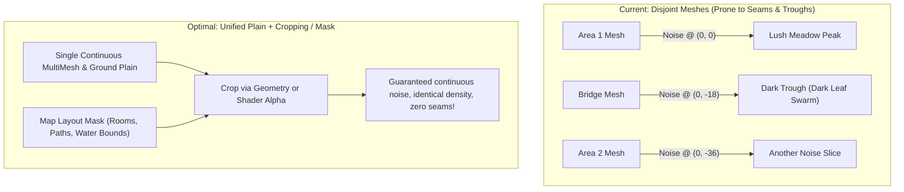

# Stylized Grass Shader & Procedural Terrain Architecture Guide

This guide breaks down how the stylized grass rendering pipeline works in **Godot-AI**, explains the optical illusion behind the painterly meadow look, analyzes why expanding the map to procedural sections disrupted the texture, and details how the "unified plain and cropping" architecture solves it.

---

## Table of Contents
1. [Core Architecture Overview](#1-core-architecture-overview)
2. [The Optical Illusion: How the Grass Shader Works](#2-the-optical-illusion-how-the-grass-shader-works)
   - [The Two Coupled Shaders](#the-two-coupled-shaders)
   - [Color Palettes and Noise Thresholding](#color-palettes-and-noise-thresholding)
   - [The "Teeth" (Grassy Lines) at Patch Boundaries](#the-teeth-grassy-lines-at-patch-boundaries)
   - [The Role of `grassleaf.png` and Silhouette Rendering](#the-role-of-grassleafpng-and-silhouette-rendering)
3. [Why Procedural Areas and Bridges Lost the Texture](#3-why-procedural-areas-and-bridges-lost-the-texture)
   - [World-Space Continuous Noise vs. Disjoint Meshes](#1-world-space-continuous-noise-vs-disjoint-meshes)
   - [Noise Peaks vs. Noise Valleys (Troughs)](#2-noise-peaks-vs-noise-valleys-troughs)
   - [Pre-Baked MultiMesh vs. Procedural Foliage](#3-pre-baked-multimesh-vs-procedural-foliage)
   - [Billboard Normal & Toon Lighting Discrepancies](#4-billboard-normal--toon-lighting-discrepancies)
4. [The Solution: "Unified Plain and Cropping" Architecture](#4-the-solution-unified-plain-and-cropping-architecture)
   - [Validation of the Cropping Intuition](#validation-of-the-cropping-intuition)
   - [How the Pond Exclusion Already Proved This](#how-the-pond-exclusion-already-proved-this)
   - [Architectural Comparison: Disjoint vs. Masked Unified Plain](#architectural-comparison)
   - [Implementation Options for Procedural Generation](#implementation-options-for-procedural-generation)
5. [Relevant Codebase References](#5-relevant-codebase-references)

---

## 1. Core Architecture Overview

The lush, painterly meadow aesthetic is not a flat ground texture or high-poly 3D models. It is an **emergent optical effect** produced by pairing a 2D floor shader with thousands of lightweight 3D billboard quads:

```
[Camera (Orthographic / 2.5D Isometric)]
                    │
                    ▼
┌──────────────────────────────────────────────────────────────────┐
│  MultiMeshInstance3D (30,000 QuadMesh blades, 0.2m x 0.3m)       │ ◄── Grass.gdshader
│  • Billboards toward camera                                      │
│  • Samples noise at blade base (object_origin.xz)                │
│  • Animated with wind swaying and character displacement         │
└──────────────────────────────────────────────────────────────────┘
                    │ (Blades stand 0.3m above the floor)
┌──────────────────────────────────────────────────────────────────┐
│  MeshInstance3D Floor (PlaneMesh Y = 0)                          │ ◄── Floor.gdshader
│  • Flat terrain canvas                                           │
│  • Samples the exact same noise at vertex_world.xz               │
│  • Renders Toon Shaded flat color zones                          │
└──────────────────────────────────────────────────────────────────┘
```

Both shaders sample the exact same mathematical noise functions at the exact same world positions. When their colors match, the blades dissolve into the floor; when their colors differ across borders, the blades stand out.

---

## 2. The Optical Illusion: How the Grass Shader Works

### The Two Coupled Shaders
The visual system depends on strict lockstep coordination between:
- [`shaders/Floor.gdshader`](file:///c:/Users/user7/PA/Godot-AI/shaders/Floor.gdshader): Renders the flat ground.
- [`shaders/Grass.gdshader`](file:///c:/Users/user7/PA/Godot-AI/shaders/Grass.gdshader): Renders the grass blade billboards.

### Color Palettes and Noise Thresholding
Both shaders define three color variables:
- **`albedo1` (Base Color)**: Dark green (`#71A200` / `RGB: 113, 162, 0`). Default fallback.
- **`albedo2` (Light Green Patch)**: Bright yellow-green (`#8EAD36` / `RGB: 142, 173, 54`).
- **`albedo3` (Medium Green Patch)**: Olive / meadow green (`#80A739` / `RGB: 128, 167, 57`).

Two continuous 2D `FastNoiseLite` textures control where these colors appear:
- [`assets/Albedo2Noise.tres`](file:///c:/Users/user7/PA/Godot-AI/assets/Albedo2Noise.tres) (`frequency = 0.0046`, seamless)
- [`assets/Albedo3Noise.tres`](file:///c:/Users/user7/PA/Godot-AI/assets/Albedo3Noise.tres) (`frequency = 0.0052`, seamless)

In both [`Floor.gdshader`](file:///c:/Users/user7/PA/Godot-AI/shaders/Floor.gdshader#L48-L56) and [`Grass.gdshader`](file:///c:/Users/user7/PA/Godot-AI/shaders/Grass.gdshader#L313-L320):
```glsl
float albedo2_noise_tex = texture(albedo2_noise, (pos.xz + noise_offset) * albedo2_scale).r;
float albedo3_noise_tex = texture(albedo3_noise, (pos.xz + noise_offset) * albedo3_scale).r;

ALBEDO = albedo1.rgb; // Base fallback
if (albedo2_noise_tex > albedo2_threshold) { // Threshold: ~0.537
    ALBEDO = albedo2.rgb;                    // Solid Light Green
}
if (albedo3_noise_tex > albedo3_threshold) { // Threshold: ~0.471
    ALBEDO = albedo3.rgb;                    // Solid Medium Green
}
```

Because continuous noise values rise and fall smoothly across space, thresholding them at `0.537` and `0.471` carves out organic islands of light and medium green over a dark green base.

### The "Teeth" (Grassy Lines) at Patch Boundaries
The central question: **Why does Area 1 look like a clean, soft painterly painting rather than thousands of noisy blades?**

1. **Inside a Patch (`albedo2` or `albedo3`):**
   - The floor is solid `albedo2`.
   - The grass blades standing on that floor are also solid `albedo2`.
   - Because the blade and the floor share the **exact same color**, the grass blades **blend invisibly into the ground**. You do not see individual blades cluttering the screen.
2. **At Patch Boundaries:**
   - On the floor plane, the color boundary is a mathematically crisp curve.
   - However, the grass blades are 3D billboards standing **0.3 meters high**.
   - A blade standing inside the `albedo2` patch reaches upward and visually overlaps the darker `albedo1` or `albedo3` floor behind it in the isometric view.
   - A blade standing in `albedo1` reaches up against an `albedo2` background.
   - **This physical overlap creates the "teeth" / "grassy lines" along patch edges.** They are not drawn on a texture; they are the 3D silhouettes of light grass tufts popping against darker ground behind them.

### The Role of `grassleaf.png` and Silhouette Rendering
The texture [`assets/grassleaf.png`](file:///c:/Users/user7/PA/Godot-AI/assets/grassleaf.png) is a small 24x24 pixel monochrome mask containing three grass blade shapes with an alpha channel.

Look at the difference in how colors are assigned in [`shaders/Grass.gdshader`](file:///c:/Users/user7/PA/Godot-AI/shaders/Grass.gdshader#L315-L320):
```glsl
ALBEDO = albedo1.rgb * albedo_tex.rgb; // Base: Multiplied by grassleaf.png
if (albedo2_noise_tex > albedo2_threshold) {
    ALBEDO = albedo2.rgb;              // Overridden with flat solid color!
}
if (albedo3_noise_tex > albedo3_threshold) {
    ALBEDO = albedo3.rgb;              // Overridden with flat solid color!
}
ALPHA = albedo_tex.a;                  // Cutout quad shape
```

- In `albedo2` and `albedo3`, `ALBEDO` is assigned a **flat solid color**, completely ignoring `albedo_tex.rgb`. The blade only uses `albedo_tex.a` to trim the quad geometry into a grass blade silhouette.
- In `albedo1`, `ALBEDO` is multiplied by `albedo_tex.rgb`. If `albedo1` dominates, every single blade becomes a high-contrast dark leaf silhouette.

---

## 3. Why Procedural Areas and Bridges Lost the Texture

When we expanded from a single isolated map to connected rooms and bridges in [`world/procedural_world.gd`](file:///c:/Users/user7/PA/Godot-AI/world/procedural_world.gd), the visual consistency broke. Here is why:

### 1. World-Space Continuous Noise vs. Disjoint Meshes
In the shaders, noise is sampled using **world coordinates**:
```glsl
vertex_world.xz * scale
object_origin.xz * scale
```
The noise is **not** stretched to fit the mesh bounds $(0 \to 1)$. It is an infinite continuous mathematical wave spread across the Godot universe $(X, Z)$.

```
World Z Coordinate:
   +12.5m ─────────── 0.0m ─────────── -12.5m ─────────── -23.5m ─────────── -36.0m
   [               Area 1               ]     [    Bridge    ]     [     Area 2     ]
         NOISE PEAK (Values > 0.5)               NOISE VALLEY          NOISE RIDGE
   (Lush Light/Medium Green Meadows)         (Drops below 0.47)     (Meadows return)
                                             (Falls to albedo1!)
```

- **Area 1** ($Z \in [-12.5, 12.5]$): Centered around $(0, 0)$. In the seed of `Albedo2Noise` and `Albedo3Noise`, $(0, 0)$ happened to sit on a **peak** with high noise values. Over 70% of Area 1 is covered by large Light Green and Medium Green patches.
- **The Bridge** ($Z \in [-23.5, -12.5]$): Placed north of Area 1. At $Z = -18$, the mathematical noise function dipped into a **valley (trough)** where values dropped below `0.471`.
- **The Result**: The bridge fell almost entirely into `albedo1` (Dark Green base). Instead of standing inside a soft light patch with occasional edge teeth, the player was surrounded by thousands of dark `albedo1` blades.

### 2. Billboard Normal & Toon Lighting Discrepancies
Why did `albedo1` look like a swarm of dark leaves instead of a flat dark floor?
- The floor plane normal points **straight up** (`(0, 1, 0)`).
- The grass quad normals are billboarded to **face the camera** in [`shaders/Grass.gdshader`](file:///c:/Users/user7/PA/Godot-AI/shaders/Grass.gdshader#L265-L270).
- Because the surfaces face different directions, Godot's directional light and toon stepped shading (`cuts = 3`) hit the floor and the grass quads differently. In `albedo2` or `albedo3`, the bright colors overwhelm this difference. In `albedo1`, the blades cast high-contrast dark silhouettes against the ground.

### 3. Pre-Baked MultiMesh vs. Procedural Foliage
- **Area 1 & Area 2** use [`assets/grass_multimesh.tres`](file:///c:/Users/user7/PA/Godot-AI/assets/grass_multimesh.tres). This is a pre-baked Godot resource containing exactly 30,000 instance transforms distributed across a 25m x 25m footprint.
- Because a bridge is narrow ($6\text{m} \times 11\text{m}$), we could not use `grass_multimesh.tres` directly without blades spilling into the water. The bridge had to use a procedurally generated `MultiMesh` via `_create_foliage_multimesh()`.
- Discrepancies in quad distribution, density (48 blades/$m^2$), and random seed made the bridge foliage contrast even more with the hand-tuned pre-baked layout.

---

## 4. The Solution: "Unified Plain and Cropping" Architecture

### Validation of the Cropping Intuition
> *"I thought we can generate a flat plain with our shader, and then crop out portions to match our actual map information"*

This intuition is **architecturally optimal for stylized 2.5D games**. Rather than stitching disjoint rectangular meshes together and hoping world noise aligns nicely, the world is treated as one continuous canvas, and map information (rooms, corridors, water) is applied as a **geometric or shader crop**.

### How the Pond Exclusion Already Proved This
The spawn pond in Area 1 already used this exact cropping technique. In [`shaders/Grass.gdshader`](file:///c:/Users/user7/PA/Godot-AI/shaders/Grass.gdshader#L273-L280):

```glsl
// Exclude grass blades from inside the organic water pool
if (water_pool_radius > 0.0) {
    float pool_angle = atan(object_origin.z - water_pool_center.z, object_origin.x - water_pool_center.x);
    float pool_distort = sin(pool_angle * 2.0) * 0.45 + cos(pool_angle * 3.0 + 0.8) * 0.3 + sin(pool_angle * 5.0) * 0.15;
    float dynamic_bound = 2.45 + pool_distort;
    if (distance(object_origin.xz, water_pool_center.xz) < dynamic_bound) {
        VERTEX = vec3(0.0); // Collapse blade geometry inside the water!
    }
}
```

The grass mesh was not cut into a ring with a hole in Blender; it remained a single continuous field of blades. The shader simply collapsed `VERTEX = vec3(0.0)` for any blade whose world position fell inside the pond boundary!

### Architectural Comparison



### Implementation Options for Procedural Generation

#### Approach A: Local-Normalized Sampling (Fastest, Drop-in Fix)
If keeping separate meshes for rooms and bridges:
- Give each section its own local UV or centered offset in the shader.
- Instead of raw `vertex_world.xz`, sample `(vertex_local.xz) * scale`.
- **Result**: Every room and every bridge gets the exact same proportional distribution of Light Green, Medium Green, and teeth boundaries as Area 1, regardless of where it is placed in the world.

#### Approach B: Continuous World Grid with SDF / Boundary Mask (The Grand Plain)
- Generate a single unified `PlaneMesh` and `MultiMesh` covering the maximum map extent (e.g., $100\text{m} \times 100\text{m}$).
- Feed a 2D viewport texture or Signed Distance Field (SDF) of the map layout (rooms + corridors) into the shader.
- Where the mask is `0.0` (water), collapse the grass blades (`VERTEX = vec3(0.0)`) and drop the floor height below the water plane.
- Where the mask is `1.0` (walkable meadow), render the grass and floor normally.
- **Result**: 100% continuous grass and floor with organic shorelines and zero mesh seams.

#### Approach C: Low-Frequency Noise Calibration
- Adjust the noise frequencies in [`assets/Albedo2Noise.tres`](file:///c:/Users/user7/PA/Godot-AI/assets/Albedo2Noise.tres) and [`assets/Albedo3Noise.tres`](file:///c:/Users/user7/PA/Godot-AI/assets/Albedo3Noise.tres) so the wave period is much larger than individual rooms ($> 100\text{m}$ instead of $\approx 10\text{m}$).
- Lower the thresholds on corridor sections so corridors are guaranteed to carry the bright meadow path through them.

#### Approach D: MultiMesh Instance Cropping (The Implemented Solution)
Rather than writing synthetic generator algorithms for non-standard section shapes:
1. Retain the **exact original materials** ([`assets/floor_material.tres`](file:///c:/Users/user7/PA/Godot-AI/assets/floor_material.tres) and [`assets/grass_material.tres`](file:///c:/Users/user7/PA/Godot-AI/assets/grass_material.tres)) with zero noise offsets across all rooms and bridges.
2. For connecting bridges or irregular corridors, **crop instance transforms directly** from [`assets/grass_multimesh.tres`](file:///c:/Users/user7/PA/Godot-AI/assets/grass_multimesh.tres) using bounding volume bounds (`crop_rect`).
3. This guarantees:
   - 100% identical quad mesh geometry, dimensions ($0.2\text{m} \times 0.3\text{m}$), and alternating crossed-quad basis.
   - 100% identical blade density ($48\text{ blades/m}^2$).
   - Seamless color blending and patch boundary teeth with no dark leaf clusters.

---

## 5. Relevant Codebase References

### Shaders
- [`shaders/Grass.gdshader`](file:///c:/Users/user7/PA/Godot-AI/shaders/Grass.gdshader): MultiMesh grass blade vertex billboarding, wind animation, character displacement, and noise thresholding.
- [`shaders/Floor.gdshader`](file:///c:/Users/user7/PA/Godot-AI/shaders/Floor.gdshader): Ground toon shading, noise patch sampling, and pond shoreline blending.
- [`shaders/clouds.gdshaderinc`](file:///c:/Users/user7/PA/Godot-AI/shaders/clouds.gdshaderinc): Cloud shadow projection included by both shaders.

### Materials & Resources
- [`assets/grass_material.tres`](file:///c:/Users/user7/PA/Godot-AI/assets/grass_material.tres): Grass material uniforms (`albedo1`, `albedo2`, `albedo3`, thresholds).
- [`assets/floor_material.tres`](file:///c:/Users/user7/PA/Godot-AI/assets/floor_material.tres): Ground material uniforms.
- [`assets/grass_multimesh.tres`](file:///c:/Users/user7/PA/Godot-AI/assets/grass_multimesh.tres): Pre-baked 30,000 instance MultiMesh for $25\text{m} \times 25\text{m}$ areas.
- [`assets/grassleaf.png`](file:///c:/Users/user7/PA/Godot-AI/assets/grassleaf.png): 24x24 monochrome grass blade cutout texture.
- [`assets/Albedo2Noise.tres`](file:///c:/Users/user7/PA/Godot-AI/assets/Albedo2Noise.tres): Light green patch noise.
- [`assets/Albedo3Noise.tres`](file:///c:/Users/user7/PA/Godot-AI/assets/Albedo3Noise.tres): Medium green patch noise.

### Procedural World & Runtime
- [`world/procedural_world.gd`](file:///c:/Users/user7/PA/Godot-AI/world/procedural_world.gd): Area, bridge, collision barrier, and multimesh cropping implementation (`_crop_multimesh`).
- [`main.gd`](file:///c:/Users/user7/PA/Godot-AI/main.gd): Camera controls, teleportation between sections, and player spawning.

### Visual Comparison Captures
- [Three Sections Restored Comparison](file:///C:/Users/user7/.gemini/antigravity/brain/bfe54145-4c20-4a5f-8aa0-b508413ca89b/three_sections_restored_comparison.png): Side-by-side comparison of Area 1, Cardinal Bridge, and Area 2 with restored old terrain and cropped foliage.
- [Zoomed Three Sections Comparison](file:///C:/Users/user7/.gemini/antigravity/brain/bfe54145-4c20-4a5f-8aa0-b508413ca89b/zoomed_three_sections_comparison.png): 1:1 pixel zoom over Area 1, Bridge, and Area 2 demonstrating identical teeth contours and blade density.
- [Restored Two Rectangular Areas Overview](file:///C:/Users/user7/.gemini/antigravity/brain/bfe54145-4c20-4a5f-8aa0-b508413ca89b/two_rectangular_areas_restored_overview.png): Full map overview showing seamless meadow texture across both areas and connecting bridge.
- [Area 1 Player View](file:///C:/Users/user7/.gemini/antigravity/brain/bfe54145-4c20-4a5f-8aa0-b508413ca89b/area_1_player_view.png): Reference image showing the soft, painterly meadow with teeth along patch boundaries.
- [Area 2 Player View](file:///C:/Users/user7/.gemini/antigravity/brain/bfe54145-4c20-4a5f-8aa0-b508413ca89b/area_2_player_view.png): Reference image showing the second rectangular area.
- [Bridge Player View](file:///C:/Users/user7/.gemini/antigravity/brain/bfe54145-4c20-4a5f-8aa0-b508413ca89b/.system_generated/steps/2474/media_0.png): Live in-game player view on the bridge with restored painterly foliage.
